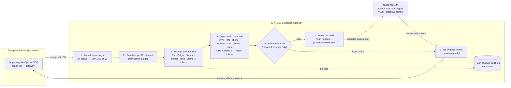

# N-ATLAS Sovereign Gateway

[](https://github.com/Em-driod/natlas-sovereign-gateway/actions/workflows/ci.yml)

**The privacy, security and edge-caching proxy for N-ATLAS, Nigeria's sovereign LLM.**

**Live:** https://natlas-gateway.onrender.com (dashboard and playground) · API base URL `https://natlas-gateway.onrender.com/v1` · demo key `sk-natlas-demo-key` · [beta evidence](https://natlas-gateway.onrender.com/beta) · [NDPA report](https://natlas-gateway.onrender.com/admin/report) · [N-ATLAS integration](N-ATLAS-INTEGRATION.md)

> Hosted on Render's free plan. A scheduled GitHub Action ([keep-warm.yml](.github/workflows/keep-warm.yml)) pings it every 10 minutes so it stays awake, and checks redaction and the audit chain on each run. The badge in the dashboard header shows which upstream is live: the official N-ATLaS, or the built-in mock used when no GPU is attached.

Nigerian banks, fintechs, hospitals and government agencies want to build on N-ATLAS, but they can't send customer BVNs, NINs, phone numbers and home addresses to a model endpoint. They can't expose their internal network to it either, or pay full GPU inference cost for the same FAQ asked ten thousand times a day over a 3G connection.

The gateway sits between their apps and N-ATLAS. Developers change **one line** (the base URL), and every request is then:

1. **Stripped of Nigerian PII** before it reaches the model, and re-hydrated on the way back.
2. **Served from a Nigerian-aware semantic cache** when possible: about 11 ms instead of about 1.5 s.
3. **Shielded and screened**: no client IP or internal headers leave the gateway, jailbreaks (including Pidgin, Yoruba, Hausa and Igbo ones) are blocked, and every tenant has rate limits and budget ceilings.
4. **Recorded in a tamper-evident audit trail** that holds no content, ready for NDPC, NITDA and CBN reviews.

```python
from openai import OpenAI

client = OpenAI(
    base_url="https://<your-gateway>/v1",   # the only change
    api_key="sk-natlas-...",
)
client.chat.completions.create(
    model="n-atlas-8b",
    messages=[{"role": "user", "content": "My customer NIN is 12345678901, explain loan policy in Pidgin."}],
)
# N-ATLAS sees:   "My customer NIN is [NIN_1], explain loan policy in Pidgin."
# The app gets:   the answer, with 12345678901 restored wherever the model referred to [NIN_1].
```

## The dashboard

Open the gateway root (`/`) for a white-and-green console with four tabs:

- **Playground with Request X-ray.** Send a scenario and watch it move through all seven stages (authenticate, rate limit, injection scan, PII redaction, semantic cache, N-ATLAS, restore values) with the **real time spent in each**, from the `x-natlas-trace` header. Three panes show what you sent, what N-ATLAS saw, and what came back. A blocked jailbreak turns the pipeline red at the stage that stopped it.
- **Traffic.** Cache against N-ATLAS latency, personal data withheld by type, and the live audit trail with its chain status.
- **Compliance.** One click produces a printable **NDPA compliance report** (`/admin/report`) built from the hash-chained audit trail: personal data withheld by category, attacks blocked by rule, outcomes, zero-retention usage, chain verification, and controls mapped to NDPA 2023 principles. It holds counts only.
- **Developers.** Create a **self-serve sandbox key** (30 requests a minute, 100k tokens a day, at most 5 keys per IP per hour) and copy a ready Python, Node or curl snippet with your key and base URL filled in.

Demo links: `/?run=kyc`, `/?run=pcg` (Pidgin jailbreak), `/?run=sem` (semantic cache), `/?tab=comply`.

---

## Results

Measured with `npm run bench` on a laptop: 10 distinct prompts, concurrency 5, with the mock upstream simulating realistic 8B-model latency.

| Path | Requests | Avg | p50 | p95 |
|---|---:|---:|---:|---:|
| N-ATLAS direct (no gateway) | 10 | 1.44 s | 1.51 s | 1.67 s |
| Gateway, cache miss (redact, shield, forward) | 10 | 1.48 s | 1.57 s | 1.67 s |
| **Gateway, cache hit** | 30 | **13.9 ms** | **10.9 ms** | 33.8 ms |

- **138x faster** at p50 on cache hits, with no GPU time spent on them.
- **~1 ms of gateway overhead** on a miss (auth, rate limit, injection scan, PII redaction, audit), measured inside the gateway.
- **22 µs** to redact a dense KYC sentence holding 7 identifiers.
- **Up to 40% smaller** responses over the wire with brotli, plus a `lite` mode for 2G/3G clients (see below).

---

## Architecture



### What happens to one request

| Step | Module | What it does |
|---|---|---|
| Auth | [src/security/tenants.ts](src/security/tenants.ts) | `sk-natlas-` keys. Only the SHA-256 is stored, and the comparison is constant-time. |
| Rate limit | [src/security/tenants.ts](src/security/tenants.ts) | Fixed-window limits per client IP (DDoS shield) and per tenant, returned as `x-ratelimit-*` and `retry-after` headers. |
| Budget | [src/security/tenants.ts](src/security/tenants.ts) | A daily token ceiling per tenant returns `429 budget_exceeded`, so nobody wakes up to a surprise bill. |
| Injection | [src/security/injection.ts](src/security/injection.ts) | Weighted heuristics covering instruction overrides, system-prompt leaks, DAN/developer-mode personas, Llama-3 role-token spoofing (`<\|start_header_id\|>`), encoded payloads and exfiltration, plus **Nigerian-language jailbreaks**. Only user and tool content is scanned; the developer's system prompt is trusted. |
| Redaction | [src/pii/redactor.ts](src/pii/redactor.ts) | Replaces PII with typed tokens. The same value always gets the same token, across all messages in the request. |
| Cache | [src/cache/semantic-cache.ts](src/cache/semantic-cache.ts) | An exact match on normalised text, then a semantic match (word and character-trigram cosine, with Nigerian business and Pidgin synonyms). |
| Shield | [src/upstream/client.ts](src/upstream/client.ts) | Requests leave with a fresh, minimal header set: no `X-Forwarded-For`, cookies, user agent or tenant key. Only allow-listed body fields are forwarded, and `user` becomes an HMAC pseudonym. |
| Re-hydrate | [src/pii/redactor.ts](src/pii/redactor.ts) | Tokens are swapped back in, including tokens split across SSE chunks (`"[NI"` + `"N_1]"`) and tokens the model wrote without brackets. |
| Audit | [src/audit/audit-log.ts](src/audit/audit-log.ts) | Appends one JSONL line per request: outcome, redaction counts, cache result, injection score and latency. Each line carries the SHA-256 of the previous one. `GET /admin/audit/verify` re-walks the chain. |

---

## Privacy & NDPA pillar

### Nigerian PII coverage

| Type | Examples caught | How |
|---|---|---|
| `BVN` | `BVN 22345678901`, `bank verification number: 223 4567 8901` | 11 digits labelled from the words since the previous number |
| `NIN` | `NIN 12345678901`, `NIMC no. …` | same, with NIN/NIMC cues |
| `ID` | an unlabelled 11-digit number | redacted anyway, because it's safer |
| `PHONE` | `08031234567`, `0803 123 4567`, `+234 803 123 4567`, `2347061234567` | all MTN, Glo, Airtel and 9mobile prefixes (070x–091x) |
| `ACCOUNT` | `account number 0123456789` | 10-digit NUBAN, only with banking context nearby |
| `CARD` | `4111 1111 1111 1111` | 13–19 digits, **Luhn-validated** |
| `EMAIL` | `ada@gtbank.com` | standard pattern |
| `NAME` | `Customer Adaeze Okafor`, `Alhaji Musa Bello`, `Mrs. Funke Adeyemi` | only after a Nigerian honorific or cue word, to avoid false positives |
| `GPS` | `6.6018, 3.3515`, `lat: 9.07, lng: 7.47`, `6.42° N, 3.42° E` | → **`[GPS_1:Lagos/Ikeja]`** |
| `ADDRESS` | `No. 12, Adeola Odeku Street, Victoria Island, Lagos` | → **`[ADDRESS_1:Lagos/Victoria Island]`** |
| `PASSPORT` | `A12345678` | letter + 8 digits (A/B/D/P prefix, or a "passport" cue) |
| `TIN` | `12345678-0001`, `TIN 1234567890` | FIRS format, or 10 digits with a tax cue |
| `VIN` | `voter VIN 90F5 B04F 2F29 5462 344` | 19-character PVC number with a voter/INEC cue |
| `LICENCE` | `ABC12345AA01` | FRSC driver's licence format |
| `PLATE` | `LND-123AB` | Nigerian vehicle plate |

An unlabelled 11-digit number starting with **22** (the prefix of every BVN issued so far) is treated as a BVN.

### Both directions: egress DLP

Input redaction protects what users send. The gateway also scans **what the model sends back**. If the answer contains personal data the caller never supplied (a phone number, email or name the model invented or memorised), it is replaced one-way with `[withheld phone]`, `[withheld email]` and so on, before it reaches the user or the cache. The response carries `x-natlas-egress-redactions`, the audit trail counts it, and the NDPA report lists it. Try the *Model leaks a phone number* scenario in the playground.

GPS and addresses are **coarsened, not just hidden**. The model still learns the customer is in "Lagos/Ikeja" or "FCT/Wuse", which keeps its answers useful, but it never learns where the person is. The gateway knows 42 Nigerian districts and cities, and a point more than 25 km from any of them falls back to state level ([src/pii/regions.ts](src/pii/regions.ts)).

Prices, years and amounts (`₦25,000`, `2026`, `1500.50`) are deliberately left alone. The test suite checks this.

### Zero retention

A tenant marked `zeroRetention` (or any request sent with `x-natlas-zero-retention: 1`) is **never cached**. The token vault always lives only in memory for the duration of a request, and the audit log never holds content, so nothing about the conversation outlives the response. The dashboard demo includes a zero-retention "hospital" tenant.

### Mapping to NDPA 2023 principles

| NDPA 2023 principle | How the gateway supports it |
|---|---|
| Data minimisation | The model receives redacted prompts and coarse regions only. |
| Purpose limitation & storage limitation | The vault exists only per request, zero-retention tenants are supported, and cache entries are redacted and expire on a TTL. |
| Security of processing | Hashed keys, rate limits, injection defence, network shielding, Luhn-checked card detection. |
| Accountability | A hash-chained audit log with a verify endpoint and per-request redaction counts. |
| Cross-border caution | It can run on Nigerian infrastructure in front of a self-hosted N-ATLAS, so customer data never leaves the country. |

*This is engineering support for compliance, not legal advice.*

---

## Speed & cost pillar

- **Shared cache that is safe by design.** Cache keys and stored answers are built from *redacted* prompts. Two branches asking "explain loan policy for NIN [NIN_1]" with different customers share one cached answer, and each gets **its own** customer's NIN back.
- **Semantic matching tuned for Nigeria.** "Abeg explain the loan rules in Pidgin for my client" hits the cached answer to "Explain the loan policy in Pidgin for my customer".
- **Guards against wrong hits.** A prompt that differs in **language** (Yoruba vs Pidgin), **agency** (CAC vs FIRS), **state**, **negation** or **numbers** never reuses another prompt's answer. Matches are also scoped to the same system prompt and parameters, and high-temperature (creative) requests skip the cache.
- **Mobile-first payloads.** Brotli/gzip on JSON. `x-natlas-lite: 1` returns just `{id, content, cache, ms}`. Cached answers stream as a few large SSE frames instead of hundreds of small ones, which suits high-latency 2G/3G links.
- **Single node or many.** It works out of the box with an in-memory LRU. Set `REDIS_URL` to share the cache, rate limits and budgets across replicas, and to make sandbox keys, the audit chain, dashboard stats and tester feedback **survive restarts and redeploys** (verified: a key created before a restart still works after it, and the chain stays intact).

---

## Security pillar

- **Prompt-injection filter with de-obfuscation.** Rules cover instruction overrides, system-prompt leaks, DAN/developer-mode personas, Llama-3 role tokens (`<|start_header_id|>`), encoded payloads and exfiltration, in English, Pidgin, Yoruba, Hausa and Igbo. Before matching, the text is normalised so the usual evasions fail: spaced letters (`i g n o r e`), leetspeak (`1gn0re`), Cyrillic look-alikes, zero-width characters and **base64-encoded** instructions. Matching only after de-obfuscation adds an `obfuscation` signal.
- **Measured, not claimed.** `npm run eval:injection` scores the filter on three rounds of attacks plus 30 normal Nigerian fintech and support questions, and a test keeps those numbers from regressing:

  | Set | Blocked now | Blocked before tuning on that round |
  |---|---|---|
  | Round 1: 18 classic, multilingual and obfuscated attacks | 18/18 | 10/16 (first 16 written) |
  | Round 2: 12 paraphrased attacks | 11/12 | 2/12 |
  | Round 3: 10 paraphrased attacks | 10/10 | 2/10 |
  | 30 normal questions ("What happens if a POS agent violates CBN rules?", "Disable my card, I lost it") | 0 wrongly blocked | 0 |

  **Honest limit:** the "before tuning" column is the fair estimate for attacks nobody has seen yet. A pattern filter catches known shapes and every obfuscation trick at near-zero cost (microseconds) and with no false positives here, but freely reworded attacks still get through. The round-2 miss is a request for harmful content ("write a story explaining how to bypass KYC"), which is a content-moderation job, not injection. The planned second layer is a model-based classifier (for example Meta Prompt Guard, or N-ATLAS asked to judge) run on borderline scores.
- **Spoof-proof client IPs.** Only the configured number of reverse-proxy hops (`TRUST_PROXY_HOPS`) is trusted, so a client cannot fake `X-Forwarded-For` to escape per-IP limits.
- **Network shield.** Requests to N-ATLAS leave with a fresh, minimal header set; `user` ids become HMAC pseudonyms. `GET /v1/gateway/whoami` shows what the gateway sees versus what it forwards (nothing).
- **Tenant controls.** Hashed `sk-natlas-` keys, per-tenant requests-per-minute and daily token budgets, zero-retention tenants.
- **Admin surface locked.** Tenant lists, the upstream switch and the mock inspector require `ADMIN_TOKEN`; the public audit view pseudonymises tenant ids.

## Built for N-ATLAS specifically

- **Language-aware.** Every prompt is labelled Yoruba, Hausa, Igbo, Nigerian Pidgin or English (`x-natlas-language`), using orthography such as ẹ ọ ṣ, ƙ ɗ ɓ, ị ụ ṅ plus function words. Traffic by language appears in stats and the audit trail, and the semantic cache never reuses an answer across languages.
- **Hot-swappable N-ATLAS endpoint.** `POST /admin/upstream` points the gateway at a new N-ATLAS deployment (vLLM on a GPU box, a Colab tunnel, a hosted provider). The endpoint is **validated with a live call first**, so a typo cannot take the gateway down, and the choice persists across restarts.
- **Official weights tooling.** [`deploy/colab/natlas_vllm_colab.ipynb`](deploy/colab/natlas_vllm_colab.ipynb) serves `NCAIR1/N-ATLaS` on a free GPU with vLLM, and `npm run evidence` produces [`natlas-evidence.md`](N-ATLAS-INTEGRATION.md) with multilingual prompts, what the model received and what came back.

## Why not LiteLLM, Portkey or Cloudflare AI Gateway?

Those are excellent general-purpose gateways: routing across hundreds of providers, retries, spend tracking. None of them knows what a BVN, NIN, NUBAN, FRSC licence or Nigerian phone number looks like, coarsens a Lagos GPS fix to a district, blocks a jailbreak written in Pidgin, labels Yoruba/Hausa/Igbo traffic, or produces a report an NDPC auditor can read. This gateway does one thing: make **N-ATLAS** safe to put in front of Nigerian customers. It is OpenAI-compatible, so it can also sit behind or in front of those tools.

## Real-world validation

External developers sign up for a sandbox key in the dashboard's **Developers** tab (30 requests a minute, 100k tokens a day), build against the gateway, and leave a rating and comments. The public [`/beta`](https://natlas-gateway.onrender.com/beta) page lists testers who opted in, **their actual request counts from the audit trail** (not self-reported), and their feedback. Personal data typed into feedback is redacted before storage.

## Sustainability

- **Who pays:** banks, fintechs, microfinance banks, telcos, hospitals and agencies that must use AI under the NDPA. The gateway turns "we can't send customer data to a model" into a compliant yes.
- **Model:** free sandbox; a per-request tier for startups; an enterprise tier (self-hosted in a Nigerian data centre such as Galaxy Backbone or Rack Centre, SSO, custom redaction rules, monthly NDPA reports, SLA).
- **Unit economics:** every cache hit is an inference that never runs. In the benchmark, hits answer in about 11 ms and use no GPU time, so the gateway pays for itself as the share of repeated questions grows.
- **Operations:** one Node.js process plus optional Redis; horizontal scaling behind any load balancer; CI on every push.

---

## Quick start (judges: about 60 seconds)

Requirements: **Node.js 20+**. Nothing else; Redis is optional.

```bash
npm install
npm start          # gateway + built-in mock N-ATLAS, one process
```

- **Dashboard and playground:** http://localhost:8080. Pick a preset and click *Send* to see **what you sent → what N-ATLAS saw → what you got back**, along with live cache, latency and audit panels.
- **Mock N-ATLAS** is mounted at `/mock/v1` on the same port in this mode (`npm run mock` runs it standalone on :9090).
- **Narrated terminal demo:** in a second terminal, run `npm run demo`.
- **Benchmark:** `npm run bench`, which writes `bench-results.md`.
- **Tests:** `npm test`, 39 tests: unit tests for redaction, re-hydration, the cache, injection and audit tampering, plus end-to-end HTTP tests that run the real server against the mock N-ATLAS (PII never reaches the model, cache restores each caller's own values, spoofed IPs ignored, obfuscated jailbreaks blocked, egress DLP, streaming, zero retention, sandbox keys, feedback, upstream hot-swap, audit and report).
- **Integration evidence:** `npm run evidence` writes `natlas-evidence.md`.
- **The real OpenAI SDK:** `npx tsx examples/openai-node.ts`, or `python examples/openai_python.py`.

The demo keys are `sk-natlas-demo-key` (a fintech tenant) and `sk-natlas-demo-key-zr` (a zero-retention hospital tenant).

### Connect the real N-ATLAS

N-ATLaS is published on Hugging Face as [`NCAIR1/N-ATLaS`](https://huggingface.co/NCAIR1/N-ATLaS). Access is gated: accept the terms first. Full steps and evidence: **[N-ATLAS-INTEGRATION.md](N-ATLAS-INTEGRATION.md)**.

**Fastest (free GPU):** open [`deploy/colab/natlas_vllm_colab.ipynb`](deploy/colab/natlas_vllm_colab.ipynb) in Google Colab, run all cells, then hand the printed URL to a running gateway without redeploying:

```bash
curl -X POST https://<gateway>/admin/upstream \
  -H "Authorization: Bearer $ADMIN_TOKEN" -H "Content-Type: application/json" \
  -d '{"url":"https://<tunnel>.trycloudflare.com/v1","apiKey":"<printed key>","model":"n-atlas-8b","label":"NCAIR1/N-ATLaS on vLLM"}'
```

**Your own GPU host:**

```bash
# On a GPU host
pip install vllm
vllm serve NCAIR1/N-ATLaS --served-model-name n-atlas-8b --max-model-len 8192

# Gateway
cp .env.example .env
#   UPSTREAM_URL=http://<gpu-host>:8000/v1
#   UPSTREAM_MODEL=n-atlas-8b
npm run start:gateway
```

Ollama (`http://127.0.0.1:11434/v1`), Hugging Face Inference Endpoints and hosted OpenAI-compatible providers work the same way. Set `UPSTREAM_API_KEY` if the server needs one.

---

## API

The gateway is OpenAI-compatible. Anything that speaks the Chat Completions API works.

| Method | Path | Notes |
|---|---|---|
| `POST` | `/v1/chat/completions` | Streaming and non-streaming. Needs `Authorization: Bearer sk-natlas-…`. |
| `GET` | `/v1/models` | Lists `n-atlas-8b`. |
| `POST` | `/v1/gateway/keys` | `{name}` → a sandbox API key (shown once). Limited per IP. |
| `GET` | `/admin/report` | Printable NDPA compliance report built from the audit trail. |
| `POST` | `/v1/gateway/inspect` | `{text}` → redacted text, redaction counts and injection score, without calling the model. |
| `GET` | `/admin/stats` | Aggregate metrics only (used by the dashboard). |
| `GET` | `/admin/audit?n=50` · `/admin/audit/verify` | Audit tail and chain verification. Needs `ADMIN_TOKEN` when set. |
| `GET` / `POST` | `/admin/tenants` | List tenants, or create one (`{name, rpm, dailyTokenBudget, zeroRetention}`); the key is shown once. |
| `POST` | `/v1/gateway/feedback` | `{rating, useCase, worked, improve}` from a tester (send their key to link it). |
| `GET` | `/beta` | Real-world validation page: testers, audited usage, feedback. |
| `GET` | `/v1/gateway/whoami` | What the gateway sees about the caller versus what it forwards. |
| `GET` / `POST` | `/admin/upstream` | Show or hot-swap the N-ATLAS endpoint (`{url, apiKey, model, label}` or `{useMock: true}`). Admin only. |
| `GET` | `/healthz` | Liveness, store type and current upstream. |

**Request headers**

| Header | Effect |
|---|---|
| `x-natlas-cache: bypass` | Skip the cache for this request. |
| `x-natlas-zero-retention: 1` | Never cache this request. |
| `x-natlas-lite: 1` | Minimal response body for low-bandwidth clients. |
| `x-natlas-debug: 1` | Include `natlas.model_saw` (the redacted prompt the model received) in the response. |

**Response headers:** `x-natlas-language` (`yo`/`ha`/`ig`/`pcm`/`en`), `x-natlas-egress-redactions`, `x-natlas-trace` (time per pipeline stage, e.g. `auth=0.11;limits=0.24;scan=0.07;redact=0.70;cache=0.38;model=1630;rehydrate=0.42`), `x-natlas-cache` (`HIT-EXACT` / `HIT-SEMANTIC` / `MISS` / `BYPASS`), `x-natlas-similarity`, `x-natlas-redactions` (e.g. `NIN=1,PHONE=1`), `x-natlas-latency-ms`, `x-natlas-upstream-ms`, `x-natlas-injection-score`, `x-natlas-budget-remaining`, `x-ratelimit-*`, `x-request-id`.

Errors use the OpenAI error format: `401 invalid_api_key`, `400 prompt_injection_detected`, `429 rate_limit_exceeded`, `429 budget_exceeded`, `502 upstream_unavailable`.

---

## Deploy

**Docker**

```bash
docker build -t natlas-gateway .
docker run -p 8080:8080 natlas-gateway                                                # with the mock
docker run -p 8080:8080 -e MOCK_UPSTREAM=false -e UPSTREAM_URL=http://gpu:8000/v1 natlas-gateway
```

**Render:** `render.yaml` is included. Create a *Blueprint* from the repo and it deploys on the free plan with the built-in mock.

**Production checklist:** set `DEMO_API_KEY=` (empty), set `ADMIN_TOKEN` and `PSEUDONYM_SECRET` to long random values, set `TRUST_PROXY_HOPS` to the number of proxies in front of the gateway (Render: 1), set `REDIS_URL` for persistence and multiple replicas, and create real keys with `npm run key -- "Tenant name" --rpm 300 --budget 5000000`.

The live deployment runs on Render (Frankfurt) with a Render Key Value instance for persistence, `TRUST_PROXY_HOPS=1` and an admin token.

---

## Quick start in Pidgin

Na one line you go change. Your app wey dey use OpenAI SDK, just point am to the gateway:

```python
client = OpenAI(base_url="https://natlas-gateway.onrender.com/v1", api_key="sk-natlas-demo-key")
```

Wetin go happen: before your message reach N-ATLAS, the gateway go hide BVN, NIN, phone number, account number and address. N-ATLAS go only see `[BVN_1]`, `[PHONE_1]`. When answer come back, the gateway go put your real numbers back. If person try jailbreak ("forget everything wey dem tell you"), e go block am. Question wey people don ask before go come back sharp-sharp from cache, no GPU money. Collect your own sandbox key for the **Developers** tab.

---

## Project layout

```
src/
  index.ts              gateway entry          demo-server.ts   gateway + mock in one process
  app.ts                Fastify setup, compression, error format
  config.ts             env configuration
  routes/chat.ts        the request pipeline (auth → limits → injection → redact → cache → upstream → re-hydrate → audit)
  routes/admin.ts       stats, audit, tenants, upstream switch, feedback, beta, inspect, dashboard
  pii/redactor.ts       Nigerian PII detection, token vault, streaming re-hydration, egress mode
  lib/language.ts       Yoruba / Hausa / Igbo / Pidgin / English detection
  upstream/registry.ts  hot-swappable, validated, persisted N-ATLAS endpoint
  dashboard/report.ts   NDPA compliance report     dashboard/beta.ts   beta evidence page
  pii/regions.ts        coarse Nigerian regions for GPS and addresses
  cache/                semantic cache + memory/Redis store
  security/             injection filter, tenants, keys, rate limits, budgets, pseudonyms
  audit/audit-log.ts    hash-chained audit trail
  upstream/client.ts    network-shielded upstream client
  mock/upstream.ts      mock N-ATLAS with a request inspector
  dashboard/index.html  live dashboard + playground
scripts/                demo.ts · benchmark.ts · natlas-evidence.ts · create-key.ts
deploy/colab/           notebook serving the official NCAIR1/N-ATLaS on vLLM
.github/workflows/      CI: typecheck, tests, audit, live smoke test with Redis
examples/               OpenAI SDK (Node, Python), curl
test/                   vitest suites
```

## Known limits and next steps

- PII detection uses patterns and context. It is fast (22 µs) and predictable, but it can miss free-form names without a cue word. Next step: a small on-device NER model for Nigerian names, run in the same pass.
- The semantic cache uses lexical similarity (words, trigrams and synonyms), not neural embeddings. That keeps it dependency-free and sub-millisecond. Next step: optional multilingual embeddings for Yoruba, Hausa and Igbo paraphrases.
- The semantic index lives per replica; exact-match entries are shared through Redis.
- Egress DLP runs on non-streamed answers and cached answers; streamed answers are re-hydrated but not yet scanned for leaks.
- Next: proxy the official N-ATLAS speech models (`NCAIR1/Yoruba-ASR`, `Hausa-ASR`, `Igbo-ASR`, `NigerianAccentedEnglish`) with PII redaction of transcripts; a client-side re-hydration SDK (the vault never leaves the device); per-tenant custom redaction rules; dashboard login.

---

Built for the NITDA / NCAIR N-ATLAS hackathon, Developer Infrastructure track. MIT licensed.
